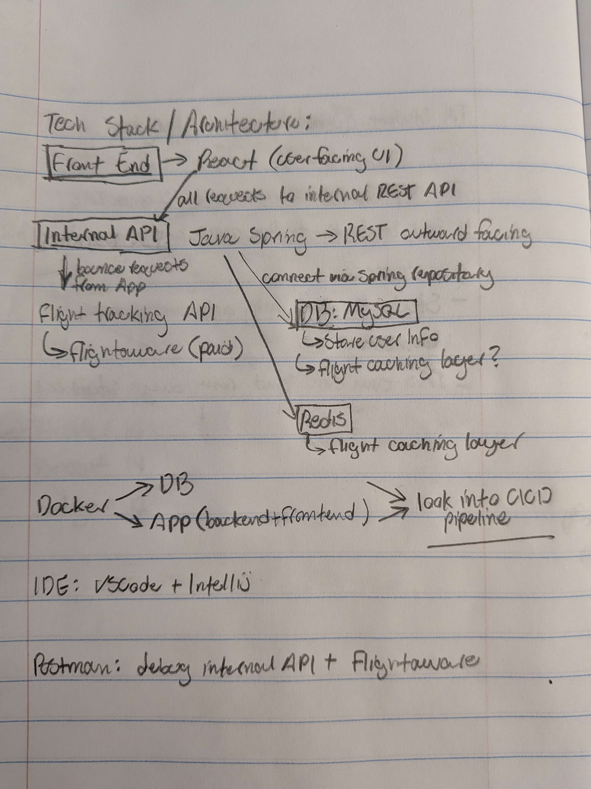
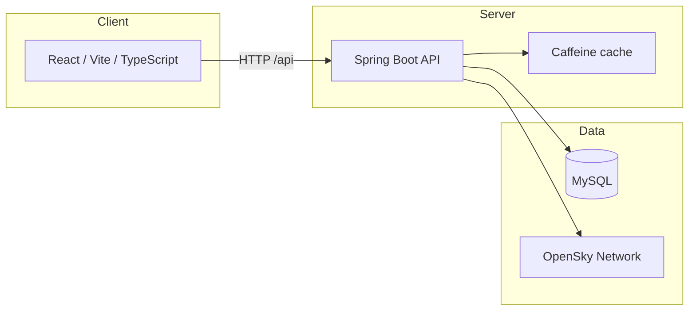
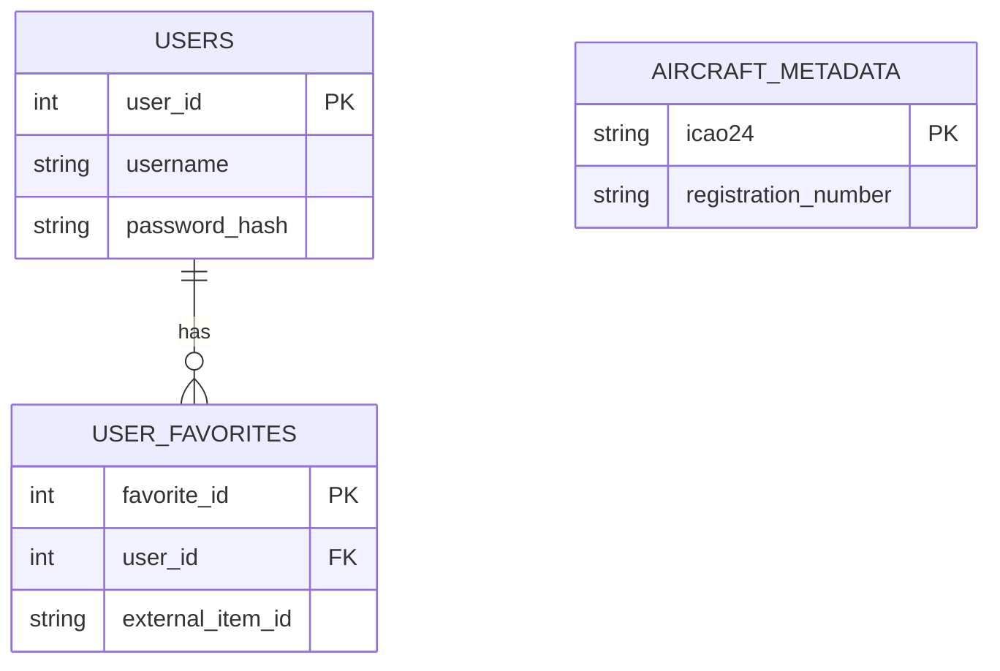

# Plane Peep

**Team t_18** — CS506 project. Plane Peep is a web app for exploring live aircraft on a map, looking up details by tail number or ICAO24, and (with an account) saving favorites.

## What it does

- **Live map** — The home page shows aircraft in the current map viewport. Positions refresh on an interval while you pan and zoom.
- **Search & details** — Search from the navbar (or jump from a favorite). Matching aircraft on the map are highlighted; a modal shows position, route-style context, and metadata when the backend has it.
- **Accounts (optional)** — Guests can browse and search. Registered users can log in (JWT stored in the browser), keep a session across refreshes, and use the **Favorites** page to add, rename, reorder, and remove saved aircraft.

For a short product-oriented description, see the in-app **About** page (`/about`).

## Architecture

Hand-drawn tech stack / architecture reference from the team specification:





- **Frontend** (`frontend/`) — React 19, TypeScript, Vite, React Router, React Bootstrap, Google Maps JavaScript API.
- **Backend** (`backend/`) — Java 21, Spring Boot, Spring Security, JWT, Spring Data JPA, Caffeine. Live positions are served from a **CONUS-wide cache** fed by the OpenSky API and filtered to the map bounds in memory. Aircraft **metadata** combines rows in MySQL (loaded via `metadata-loader`) with live state where applicable.
- **Metadata loader** (`metadata-loader/`) — Optional Docker job that imports aircraft CSV data into MySQL.

## Repository layout

| Path               | Role                                                          |
| ------------------ | ------------------------------------------------------------- |
| `frontend/`        | SPA source, tests, Docker/Vite config                         |
| `backend/`         | REST API, domain model, JUnit tests                           |
| `metadata-loader/` | DB seed / enrichment scripts                                  |
| `compose.yaml`     | Multi-service **dev** and **prod** Docker Compose definitions |
| `.gitlab-ci.yml`   | CI: Prettier, backend tests + SpotBugs, frontend Jest         |

More detail: [backend/README.md](backend/README.md), [frontend/README.md](frontend/README.md), [metadata-loader/README.md](metadata-loader/README.md).

## Prerequisites

- **Docker** with Compose v2 (recommended for full stack).
- **Node.js** (e.g. 24+) and **npm** — frontend install, tests, root Prettier / Husky.
- **JDK 21** + **Gradle** (wrapper included) — backend without containers.
- **Google Maps JavaScript API key** — required for the map (see [frontend/.env.example](frontend/.env.example)).

## Configuration

1. **Backend** — Copy [backend/.env.example](backend/.env.example) to `backend/.env` and adjust MySQL credentials and paths as needed. Compose injects this file into the DB and backend services.
2. **Frontend** — Copy [frontend/.env.example](frontend/.env.example) to `frontend/.env` and set `VITE_GOOGLE_MAPS_API_KEY`. Optionally set `VITE_API_URL` if the API is not same-origin (see [Development](#development)).

## Run with Docker (recommended)

**Development** profile — hot reload for backend and frontend, dev database, optional phpMyAdmin:

```bash
docker compose -f compose.yaml --profile dev up --build
```

**Production** profile — built images, production DB profile, metadata loader, phpMyAdmin:

```bash
docker compose -f compose.yaml --profile prod up --build
```

If the metadata loader fails on first run, rebuild or restart that service after the backend is healthy (see [metadata-loader/README.md](metadata-loader/README.md)).

### Published ports (host)

| Port | Service (typical)                                         |
| ---- | --------------------------------------------------------- |
| 8000 | Frontend (Vite in **dev**, nginx in **prod** per Compose) |
| 8001 | Backend HTTP (`/api/...`)                                 |
| 8002 | MySQL                                                     |
| 8003 | phpMyAdmin (when profile includes it)                     |

Health check: `GET http://localhost:8001/api/health` (from host; inside the stack containers use port `8080` for the app).

## Development

### Full stack in Docker

Use the **dev** Compose command above. The Vite dev server listens on **8000** and proxies `/api` to `backend-dev` (see [frontend/vite.config.ts](frontend/vite.config.ts)).

### Frontend only (against Docker backend)

From `frontend/`:

```bash
npm ci
npm run dev
```

With the backend reachable at `http://localhost:8001`, set in `frontend/.env`:

```bash
VITE_API_URL=http://localhost:8001
```

### Backend only

From `backend/`:

```bash
./gradlew build
./gradlew bootRun --args='--spring.profiles.active=dev'
```

Ensure MySQL matches your `DB_URL` / credentials (Compose exposes MySQL on host port **8002** when using the dev DB service). The backend README lists REST endpoints and legacy account routes: [backend/README.md](backend/README.md).

## API overview

Base path: `/api` (see [frontend/src/api.ts](frontend/src/api.ts) for request shapes).

| Method              | Path                          | Notes                                         |
| ------------------- | ----------------------------- | --------------------------------------------- |
| GET                 | `/api/health`                 | Liveness                                      |
| POST                | `/api/auth/register`          | Create account                                |
| POST                | `/api/auth/login`             | Returns JWT + user                            |
| GET                 | `/api/auth/me`                | Bearer JWT — session restore                  |
| GET                 | `/api/aircraft/positions`     | Query: `minLat`, `maxLat`, `minLon`, `maxLon` |
| GET                 | `/api/aircraft/metadata/{id}` | ICAO24 or identifier resolved by backend      |
| GET / POST / DELETE | `/api/favorites` …            | Authenticated favorites CRUD                  |
| PATCH               | `/api/favorites/{id}/name`    | Rename                                        |
| PATCH               | `/api/favorites/{id}/order`   | Body: `{ "direction": "up" \| "down" }`       |

Legacy favorites under `/api/account/...` remain for compatibility (see backend README).

## Testing and quality

- **Frontend** (`frontend/`): `npm run test:run` — Jest + Testing Library. `npm run lint` — ESLint.
- **Backend** (`backend/`): `./gradlew test` — JUnit. `./gradlew spotbugsMain` — static analysis (also run in CI).
- **Repo root**: `npx prettier --check .` — formatting (CI stage `prettier-check`).

## Style and conventions

Coding standards and UI direction (teal-based palette, contrast, spacing) are described in [STYLE.md](STYLE.md).

## Course: code review schedule

| CR  | Day  | Team Member | Review Moderator |
| --- | ---- | ----------- | ---------------- |
| 1   | 3/9  | Stefan      | Hunter           |
| 2   | 3/11 | Setrynn     | Vincent          |
| 3   | 3/13 | Peter       | Nikolo           |
| 4   | 3/16 | Nikolo      | Peter            |
| 5   | 3/18 | Hunter      | Stefan           |
| 6   | 3/20 | Vincent     | Setrynn          |

## Database model (high level)

Users own favorites keyed by `externalItemId` (aircraft identifier). `AircraftMetadata` stores static fields (e.g. registration, type) keyed by ICAO24, used by metadata endpoints and enriched by the metadata loader.



---

**Customer / audience:** Travelers, aviation enthusiasts, and anyone who wants a simple map-first view of live traffic and aircraft details, with optional accounts for saved aircraft.
